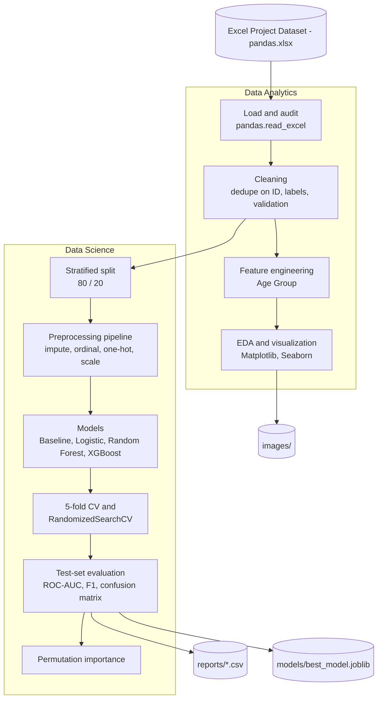
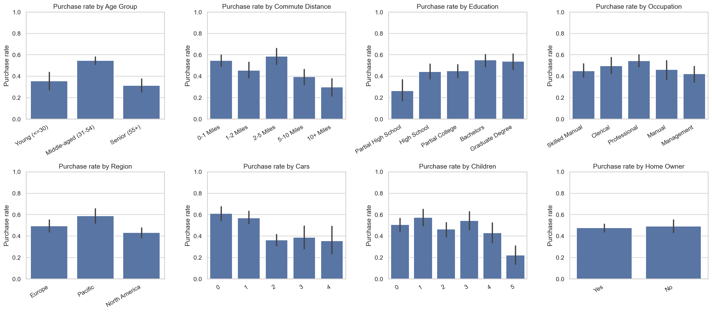
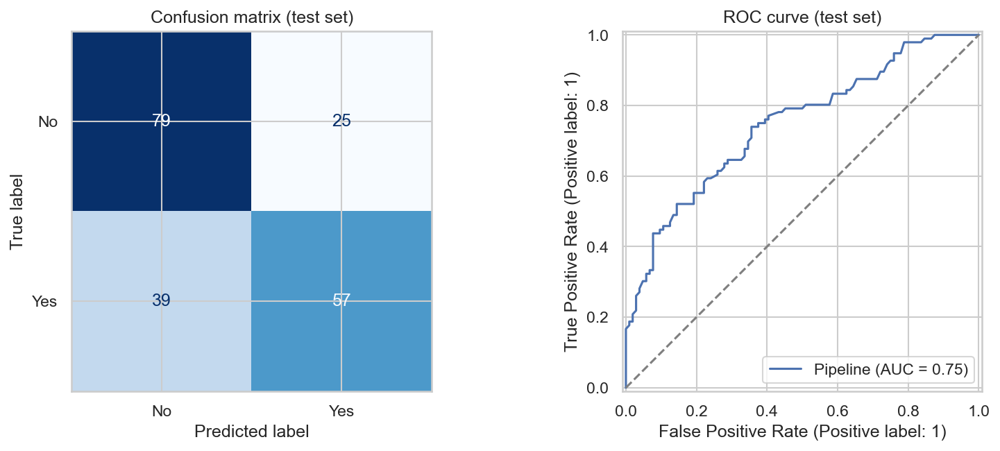
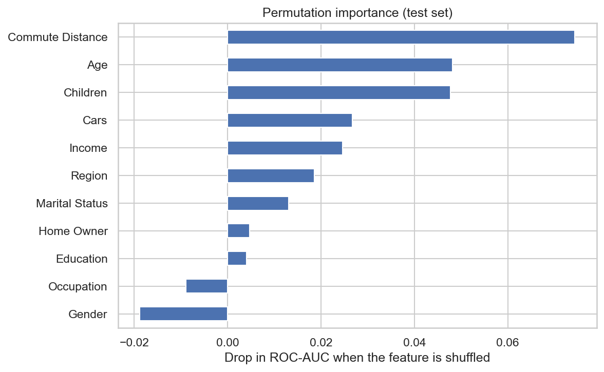

<div align="center">

# 🚲 Bike Buyers: Analytics & Purchase Prediction

**An end-to-end Data Analytics + Data Science project: from a raw Excel file to a tuned, saved machine-learning model that predicts whether a customer will buy a bike.**

<br>


[Overview](#overview) •
[Architecture](#architecture) •
[Dataset](#dataset) •
[Results](#results) •
[Getting Started](#getting-started)

</div>

---

## Table of Contents

- [Overview](#overview)
- [Tech Stack](#tech-stack)
- [Architecture](#architecture)
- [Dataset](#dataset)
- [Data Dictionary](#data-dictionary)
- [Project Structure](#project-structure)
- [Methodology](#methodology)
- [Results](#results)
- [Notebook Review and Improvements](#notebook-review-and-improvements)
- [Getting Started](#getting-started)
- [Usage](#usage)
- [Roadmap](#roadmap)
- [Author](#author)
- [License](#license)

---

## Overview

**Business question:** which customer profiles buy a bike, and can a purchase be predicted from demographic data alone?

The project covers both sides of the data profession in a single, reproducible notebook:

| Track | What it demonstrates |
|---|---|
| **Data Analytics** | Loading and auditing an Excel dataset, cleaning and validating it, feature engineering, and visual exploration of purchase rates by customer segment |
| **Data Science** | A leakage-free preprocessing pipeline, a baseline vs. three models, stratified cross-validation, hyper-parameter tuning, evaluation (ROC-AUC, F1, confusion matrix), feature importance and a saved model ready for inference |

**Key features**

- Data validation step that fails loudly on unexpected categories instead of silently creating `NaN`
- Preprocessing inside a scikit-learn `Pipeline`: no data leakage, identical logic at training and inference time
- Honest evaluation: majority-class baseline, 5-fold CV, held-out test set used once
- Reproducible: fixed seed, pinned dependency ranges, relative paths

---

## Tech Stack

| Area | Tools |
|---|---|
| Language | Python 3.10+ |
| Data handling | pandas, NumPy, openpyxl (Excel input) |
| Visualization | Matplotlib, Seaborn |
| Machine learning | scikit-learn (Pipeline, ColumnTransformer, Logistic Regression, Random Forest), XGBoost |
| Persistence | joblib |
| Environment | Jupyter Notebook |

---

## Architecture



---

## Dataset

The dataset **[`Excel Project Dataset - pandas.xlsx`](Excel%20Project%20Dataset%20-%20pandas.xlsx)** is **included in this repository** (root folder). It contains **1,000 customers** described by 12 attributes plus the target `Purchased Bike`.

> The notebook looks for the file next to itself, then in a `data/` folder. If you move it elsewhere, adjust `DATA_FILE` in the *Load & audit* cell.

## Data Dictionary

| Column | Type | Description | Values / examples |
|---|---|---|---|
| `ID` | integer | Unique customer identifier (dropped before modelling) | `12496` |
| `Marital Status` | binary | Marital status | `M` → Married, `S` → Single |
| `Gender` | binary | Customer gender | `M` → Male, `F` → Female |
| `Income` | numeric | Annual income | `40000`, `80000` |
| `Children` | integer | Number of children | `1`, `3`, `5` |
| `Education` | ordinal | Highest education level | Partial High School < High School < Partial College < Bachelors < Graduate Degree |
| `Occupation` | nominal | Job category | Professional, Skilled Manual, Clerical, Management, Manual |
| `Home Owner` | binary | Owns a home | `Yes` / `No` |
| `Cars` | integer | Number of cars owned | `0`, `1`, `2` |
| `Commute Distance` | ordinal | Distance from home to work | `0-1`, `1-2`, `2-5`, `5-10`, `10+` Miles |
| `Region` | nominal | Customer region | North America, Europe, Pacific |
| `Age` | integer | Age in years | `42`, `60` |
| `Purchased Bike` | binary (**target**) | Did the customer buy a bike? | `Yes` / `No` |
| `Age Group` | ordered category (*engineered*) | Age segment, used for analysis only | Young (≤30), Middle-aged (31-54), Senior (55+) |

---

## Project Structure

```text
bike-buyers-analytics/
├── Excel Project Dataset - pandas.xlsx   # input dataset
├── bike_buyers_analysis.ipynb            # full analysis + modelling notebook
├── requirements.txt                      # Python dependencies
├── README.md
├── images/                               # figures generated by the notebook
├── models/                               # saved model generated by the notebook
└── reports/                              # metrics generated by the notebook
```

| Path | Description |
|---|---|
| `Excel Project Dataset - pandas.xlsx` | Raw data: 1,000 customers |
| `bike_buyers_analysis.ipynb` | Load → clean → engineer → explore → model → evaluate → save |
| `requirements.txt` | Dependencies for `pip install -r` |
| `images/` | `income_by_segment.png`, `purchase_rate_by_segment.png`, `income_distribution.png`, `model_evaluation.png`, `feature_importance.png` |
| `models/best_model.joblib` | Full pipeline (preprocessing + tuned model), ready for `predict_proba` |
| `reports/` | `cv_metrics.csv` and `test_metrics.csv` |

---

## Methodology

### 1. Cleaning

| Step | Why |
|---|---|
| Drop duplicates **on `ID`**, then drop `ID` | Two different customers can share every attribute; only a repeated ID is a true duplicate |
| Trim whitespace in text columns | Avoids hidden duplicate categories |
| Replace `M/S` and `M/F` with readable labels | Readable plots and tables |
| Assert allowed values for every categorical column | Any new or misspelled category stops the notebook instead of becoming `NaN` |
| Report Income outliers (IQR rule), keep them | Tree-based models are robust to them |

### 2. Encoding (inside the pipeline)

| Feature(s) | Type | Encoding |
|---|---|---|
| `Income`, `Age`, `Children`, `Cars` | numeric | median imputation (+ standard scaling for Logistic Regression only) |
| `Marital Status`, `Gender`, `Home Owner` | binary | one-hot, one column |
| `Education`, `Commute Distance` | ordinal | ordinal encoding with the **logical order** |
| `Occupation`, `Region` | nominal | one-hot |

### 3. Modelling & evaluation

```python
# 80/20 stratified split, then 5-fold CV on the training set only
X_train, X_test, y_train, y_test = train_test_split(
    X, y, test_size=0.2, stratify=y, random_state=SEED
)
```

- **Models:** majority-class baseline, Logistic Regression, Random Forest, XGBoost
- **Tuning:** `RandomizedSearchCV` (20 iterations, ROC-AUC) for Random Forest and XGBoost
- **Model selection:** best cross-validated ROC-AUC (the test set is **not** used to choose)
- **Metrics:** accuracy, precision, recall, F1, ROC-AUC, confusion matrix, permutation importance

---

## Results

### First version of the notebook (single split, no seed)

| Model | Accuracy |
|---|---|
| Random Forest (default) | 0.755 |
| XGBoost (100 rounds, depth 4) | 0.750 |

A 200-row test set gives an accuracy standard error of about 3 points, so these two scores are statistically indistinguishable, and accuracy alone says nothing about class balance. This is what the review below addresses.

### Current version (held-out test set)

<!-- TODO: after running the notebook, copy the values from reports/test_metrics.csv -->

| Model | Accuracy | Precision | Recall | F1 | ROC-AUC |
|---|---|---|---|---|---|
| Baseline (majority class) | — | — | — | — | — |
| Logistic Regression | — | — | — | — | — |
| Random Forest (tuned) | — | — | — | — | — |
| XGBoost (tuned) | — | — | — | — | — |

### Figures

<p align="center">
  
</p>

<p align="center">
  
  
</p>

---

## Notebook Review and Improvements

The first version of the notebook was reviewed as both an analytics and a data-science project. The main fixes:

| # | Issue in v1 | Fix in the current version |
|---|---|---|
| 1 | `MinMaxScaler` fitted on the **whole** dataset before the split (data leakage); also useless for tree models | Scaling only where needed, inside a `Pipeline`, fitted on training folds |
| 2 | Nominal variables and `Education` encoded with arbitrary integers (`Bachelors = 0`, `High School = 2`, …) | One-hot for nominal, logical order for ordinal features |
| 3 | No `random_state`, no stratification: results change at every run | `SEED = 42` and `stratify=y` |
| 4 | Accuracy only, one 200-row test set, no baseline | Baseline, 5-fold CV, ROC-AUC / F1 / precision / recall, confusion matrix |
| 5 | XGBoost evaluated directly on the test set; no tuning | `RandomizedSearchCV` on training data; test set used once |
| 6 | Line plots on categorical axes (the notebook itself noted they were "meaningless") | Bar plots of purchase **rate** per segment |
| 7 | Chained `inplace` calls (`FutureWarning`), typos (`Bracketes`, `More then`), age labels (30 is not an "Adolescent"), no category validation | Clean assignments, fixed labels, ordered categories, assertions |
| 8 | No handling of missing values | Imputation inside the pipeline |

---

## Getting Started

### Prerequisites

- Python 3.10 or newer
- `git`

### Installation

```bash
git clone https://github.com/YOUR_USERNAME/bike-buyers-analytics.git
cd bike-buyers-analytics

python -m venv .venv
source .venv/bin/activate        # Windows: .venv\Scripts\activate

pip install -r requirements.txt
```

### Run the notebook

```bash
jupyter notebook bike_buyers_analysis.ipynb
```

Run all cells (**Kernel → Restart & Run All**). The notebook creates `images/`, `models/` and `reports/` automatically.

---

## Usage

Predict the purchase probability of a new customer with the saved pipeline:

```python
import joblib
import pandas as pd

model = joblib.load("models/best_model.joblib")

customer = pd.DataFrame([{
    "Marital Status": "Married", "Gender": "Female", "Income": 60000,
    "Children": 2, "Education": "Bachelors", "Occupation": "Professional",
    "Home Owner": "Yes", "Cars": 1, "Commute Distance": "0-1 Miles",
    "Region": "Europe", "Age": 35,
}])

print(f"Probability of buying a bike: {model.predict_proba(customer)[0, 1]:.1%}")
```

The raw (readable) labels are expected: the pipeline handles imputation and encoding itself.

---

## Roadmap

- [ ] Probability calibration and decision-threshold tuning
- [ ] SHAP explanations for individual predictions
- [ ] Streamlit app serving `models/best_model.joblib`
- [ ] Power BI / Tableau dashboard of the segment analysis

---

## Author

**Hamza**: Computer Science student, data science & analytics.

[GitHub](https://github.com/hamzaX12) • [LinkedIn](https://www.linkedin.com/in/hamza-ben-allou-48ab31236)

---

## License

Distributed under the MIT License. Add a `LICENSE` file to the repository root to make it effective.

<div align="center">

⭐ If this project helped you, consider giving it a star.

</div>
